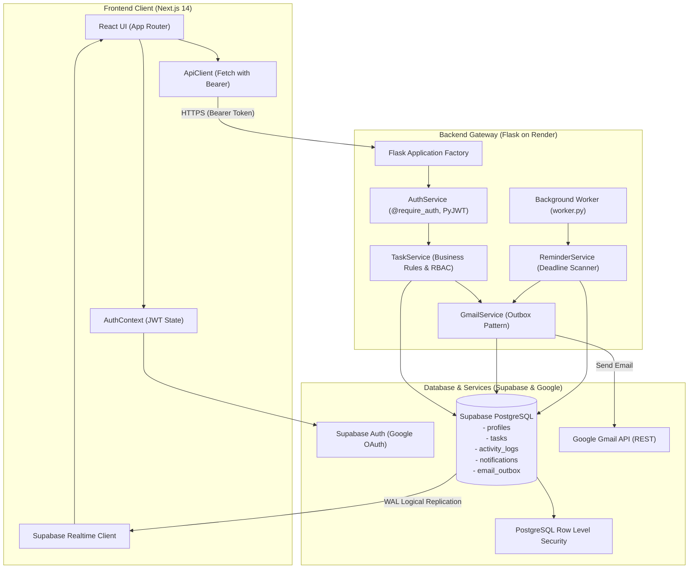
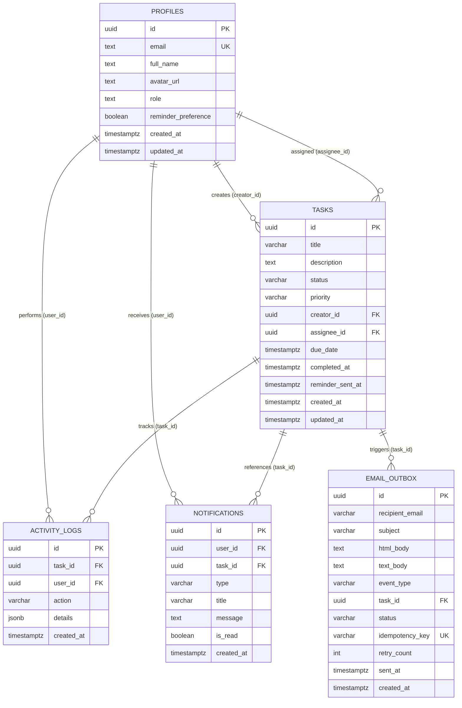

# TaskFlow — Collaborative Task & Deadline Management Platform
### Hairdrama Tech Internship Assignment | Part 2: Production Readiness, Security, Testing & Deployment

TaskFlow is a production-ready, full-stack collaborative task and deadline management platform engineered with **Next.js 14**, **Flask 3**, **Supabase PostgreSQL**, **Google OAuth 2.0**, and the **Gmail API**.

---

## 🌟 Key Features

- **Google OAuth 2.0 & Secure Sessions**: Seamless Google Sign-In with server-verified JWT claims, session restoration, and one-click demo evaluation profiles.
- **Granular Authorization & RBAC**: Strict server-side permission checks and PostgreSQL Row Level Security (RLS). Users can only view, mutate, or delete authorized tasks.
- **Dynamic Task Workflow & Kanban**: Interactive Kanban board and List view with search, multi-criteria filtering (status, priority, overdue, due soon), and chronological activity audit logs.
- **Durable Gmail Notifications (Outbox Pattern)**: Transactional email notifications on task creation, teammate assignment, and completion with idempotency duplicate prevention.
- **Proactive Deadline & Overdue Management**: Automatic overdue highlighting, time-remaining calculations, and background reminder worker respecting user preferences.
- **Supabase Realtime Sync**: Instant multi-client synchronization across active sessions using PostgreSQL logical replication channels.
- **Production-Ready Deployments**: Fully configured for **Vercel** (Frontend edge hosting) and **Render** (Gunicorn WSGI web service and background worker).

---

## 🛠️ Technology Stack

| Layer | Technologies |
| :--- | :--- |
| **Frontend** | Next.js 14 (App Router), TypeScript, Tailwind CSS, Lucide Icons |
| **Backend** | Flask 3.0, Gunicorn 22.0, PyJWT, Cryptography, Requests |
| **Database & Auth** | Supabase PostgreSQL, GoTrue / Supabase Auth, Row Level Security (RLS) |
| **Email Service** | Google API Client, Gmail API (OAuth 2.0, Scoped `gmail.send`) |
| **Testing** | Pytest, Pytest-Mock |
| **Deployment** | Vercel (Frontend), Render (Flask API & Worker) |

---

## 📐 System Architecture



---

## 📁 Repository Structure

```text
TASK/
├── backend/
│   ├── routes/              # Flask Blueprint route handlers
│   │   ├── auth_routes.py
│   │   ├── dashboard_routes.py
│   │   ├── health_routes.py
│   │   ├── notification_routes.py
│   │   ├── reminder_routes.py
│   │   ├── task_routes.py
│   │   └── user_routes.py
│   ├── services/            # Core business logic and external integrations
│   │   ├── auth_service.py      # JWT decoding, claims verification, @require_auth
│   │   ├── gmail_service.py     # Gmail API client, durable outbox, HTML templates
│   │   ├── reminder_service.py  # Deadline calculations, timezone safety
│   │   ├── supabase_client.py   # Client factory with offline test adapter
│   │   └── task_service.py      # Task CRUD, authorization, audit logs
│   ├── tests/               # Pytest automated test suite
│   ├── app.py               # Flask application factory, CORS, security headers
│   ├── config.py            # Environment configuration
│   ├── Procfile             # Render process definitions (web & worker)
│   ├── requirements.txt     # Backend Python dependencies
│   ├── worker.py            # Scheduled background worker process
│   ├── wsgi.py              # WSGI entrypoint for Gunicorn
│   └── .env.example         # Documented backend environment variables
├── frontend/
│   ├── src/
│   │   ├── app/             # Next.js App Router pages
│   │   │   ├── dashboard/   # Live KPIs and recent deliverables
│   │   │   ├── login/       # Google sign-in and demo profiles
│   │   │   ├── notifications/# User notification center
│   │   │   ├── settings/    # Profile, reminder preferences, health check
│   │   │   ├── tasks/       # Kanban board, list view, search, filters
│   │   │   ├── team/        # Teammate directory
│   │   │   ├── globals.css  # Tailwind global styles
│   │   │   ├── layout.tsx   # Root layout with AuthProvider & Navbar
│   │   │   └── page.tsx     # Public landing page
│   │   ├── components/      # Modular UI components (Badge, Modal, Navbar, Skeleton)
│   │   ├── context/         # AuthContext provider
│   │   └── lib/             # Supabase client and typed ApiClient
│   ├── package.json
│   ├── tailwind.config.js
│   ├── tsconfig.json
│   ├── vercel.json          # Vercel deployment configuration
│   └── .env.example         # Documented frontend environment variables
├── migrations/              # Versioned Supabase SQL migrations
│   ├── 001_initial_schema.sql
│   ├── 002_security_and_rls.sql
│   └── 003_realtime_and_indexes.sql
├── docs/
│   ├── demo-script.md       # 5-8 minute Loom recording script
│   ├── interview-preparation.md # 18 topic guides + 25 interview Q&As
│   └── security-review.md   # Threat model and security architecture review
├── pytest.ini               # Pytest configuration
├── render.yaml              # Render infrastructure specification
└── README.md
```

---

## 🗄️ Database Schema & Relationships



---

## 📡 REST API Endpoints

All protected endpoints require `Authorization: Bearer <token>`.

| Method | Endpoint | Description | Protected |
| :--- | :--- | :--- | :--- |
| `GET` | `/api/health` | System health and database connectivity diagnostics | No |
| `GET` | `/api/auth/profile` | Retrieve profile of authenticated user | Yes |
| `POST` | `/api/auth/sync-user` | Sync or upsert user profile from Google OAuth | Yes |
| `PUT` | `/api/auth/preferences` | Update email reminder preferences | Yes |
| `GET` | `/api/users` | List teammates for assignment | Yes |
| `GET` | `/api/tasks` | List authorized tasks with search, filters, pagination | Yes |
| `POST` | `/api/tasks` | Create task, assign teammate, queue Gmail alert | Yes |
| `GET` | `/api/tasks/<id>` | Retrieve task details with permissions verification | Yes |
| `PUT` | `/api/tasks/<id>` | Update task fields (creator, assignee, admin) | Yes |
| `PATCH` | `/api/tasks/<id>/status` | Update status (`todo`, `in_progress`, `completed`) | Yes |
| `DELETE`| `/api/tasks/<id>` | Delete task (**Creator or Admin only**) | Yes |
| `GET` | `/api/tasks/<id>/activity` | Retrieve chronological activity audit trail | Yes |
| `GET` | `/api/notifications` | List user notifications with unread count | Yes |
| `PATCH`| `/api/notifications/<id>/read` | Mark user's notification as read | Yes |
| `POST` | `/api/notifications/mark-all-read` | Mark all user notifications as read | Yes |
| `GET` | `/api/dashboard/stats` | KPI metrics (total, overdue, due soon, completion rate) | Yes |
| `POST` | `/api/reminders/process` | Trigger deadline reminders and worker cycle | Internal / Cron |

---

## ⚡ Local Setup & Installation

### Prerequisites
- Node.js 18+ and npm
- Python 3.10+
- Git

### 1. Clone & Setup Backend
```bash
cd TASK

# Create and activate Python virtual environment
python3 -m venv backend/venv
source backend/venv/bin/activate

# Install backend dependencies
pip install -r backend/requirements.txt

# Configure backend environment variables
cp backend/.env.example backend/.env
# Edit backend/.env with your Supabase and Google credentials (or leave defaults for test mode)

# Run Flask backend server
python -m backend.app
# Backend runs on http://localhost:5000
```

### 2. Setup Frontend
```bash
cd frontend

# Install dependencies
npm install

# Configure frontend environment variables
cp .env.example .env.local

# Run Next.js development server
npm run dev
# Frontend runs on http://localhost:3000
```

### 3. Run Background Worker (Optional)
```bash
# In a separate terminal with backend venv activated:
python -m backend.worker --interval 300
# Or run once:
python -m backend.worker --run-once
```

---

## 🧪 Testing & Verification

### Run Backend Automated Tests
```bash
# Run pytest from repository root:
./backend/venv/bin/pytest -v
```
All **20 tests** verify:
- Server-side JWT claims extraction and validation
- Rejection of invalid, missing, or expired tokens
- Task CRUD, inputs validation, and status transitions
- Prevention of Horizontal Privilege Escalation (unrelated users blocked with HTTP 403)
- Task deletion restricted strictly to creators and admins
- Notification creation and ownership verification
- Outbox recording and duplicate email prevention (idempotency)
- Overdue calculations, timezone boundaries, and reminder exclusions

### Run Frontend Typechecks & Production Build
```bash
cd frontend
# Check TypeScript types:
npx tsc --noEmit

# Run Next.js production build:
npm run build
```

---

## 🚀 Deployment Guide

### Frontend — Vercel
1. Import repository into [Vercel](https://vercel.com).
2. Set **Root Directory** to `frontend`.
3. Configure Environment Variables in Vercel Project Settings:
   - `NEXT_PUBLIC_SUPABASE_URL`: `https://<your-project-ref>.supabase.co`
   - `NEXT_PUBLIC_SUPABASE_ANON_KEY`: `<your-supabase-anon-key>`
   - `NEXT_PUBLIC_API_URL`: `https://<your-render-backend-domain>/api`
   - `NEXT_PUBLIC_APP_URL`: `https://<your-vercel-domain>`
4. Deploy.

### Backend — Render
1. Connect repository to [Render](https://render.com) using Blueprint (`render.yaml`) or create a **Web Service**:
   - **Root Directory**: `backend`
   - **Environment**: `Python 3`
   - **Build Command**: `pip install -r requirements.txt`
   - **Start Command**: `gunicorn backend.wsgi:app --workers 2 --bind 0.0.0.0:$PORT --timeout 120`
   - **Health Check Path**: `/api/health`
2. Set Environment Variables in Render:
   - `FLASK_ENV`: `production`
   - `FRONTEND_URL`: `https://<your-vercel-domain>`
   - `CORS_ORIGINS`: `https://<your-vercel-domain>,http://localhost:3000`
   - `SUPABASE_URL`: `https://<your-project-ref>.supabase.co`
   - `SUPABASE_SERVICE_ROLE_KEY`: `<your-supabase-service-role-key>`
   - `SUPABASE_JWT_SECRET`: `<your-supabase-jwt-secret>`
   - `GOOGLE_CLIENT_ID`: `<your-google-oauth-client-id>`
   - `GOOGLE_CLIENT_SECRET`: `<your-google-oauth-client-secret>`
   - `GMAIL_SENDER_EMAIL`: `<your-authorized-sender-email>`
   - `GMAIL_REFRESH_TOKEN`: `<your-gmail-refresh-token>`
   - `REMINDER_WINDOW_HOURS`: `24`
3. Create a Render **Background Worker**:
   - **Start Command**: `python -m backend.worker --interval 300`

### Database & Auth — Supabase
1. In the Supabase SQL Editor, execute migrations in order:
   - `migrations/001_initial_schema.sql`
   - `migrations/002_security_and_rls.sql`
   - `migrations/003_realtime_and_indexes.sql`
2. Under **Authentication -> Providers**, enable **Google**:
   - Enter your `Client ID` and `Client Secret` from Google Cloud Console.
3. Under **Authentication -> URL Configuration**:
   - Add your Vercel domain and `http://localhost:3000/dashboard` to **Redirect URLs**.

---

## 🔒 Security Notes

- **Zero Trust Client Identity**: The server never trusts client-supplied user IDs; user identity is exclusively derived from cryptographically verified token claims.
- **Durable Idempotency**: Email notifications use event hashes and idempotency keys to guarantee no recipient receives duplicate messages during retries.
- **Row Level Security**: Database-level policies enforce defense-in-depth isolation even if an application bug exists.
- **Safe Production Logging**: Secret credentials and stack traces are never exposed in production logs or responses.

---

## 📝 Hairdrama Tech Interview Resources

- **`docs/security-review.md`**: Complete threat analysis and defensive control audit.
- **`docs/interview-preparation.md`**: 18 architectural topic deep dives and 25 realistic interview questions & answers.
- **`docs/demo-script.md`**: 5–8 minute Loom recording script with timestamps.
